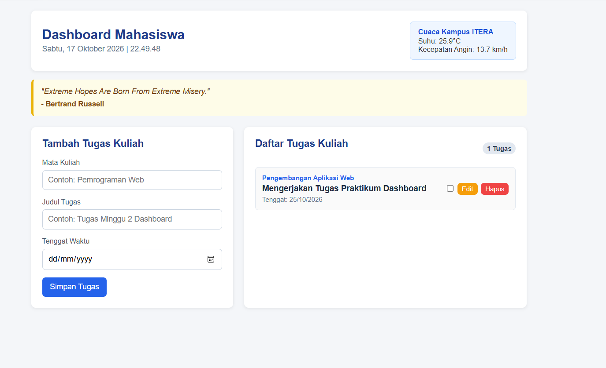
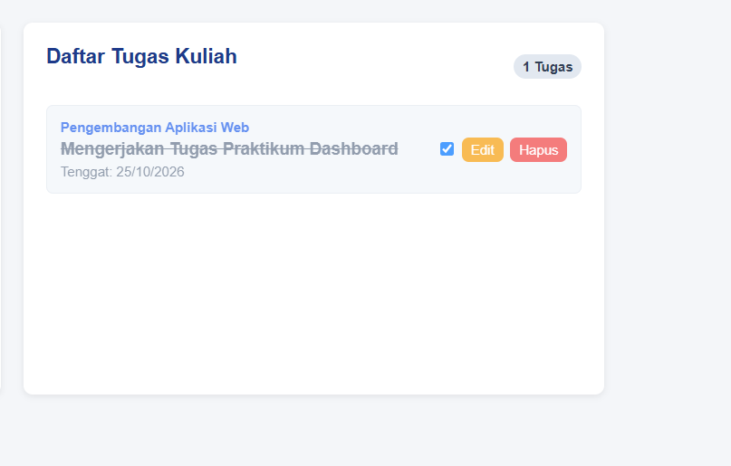
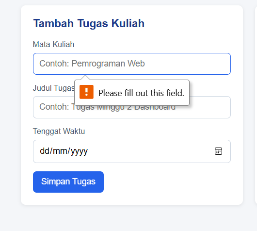

# Personal Dashboard Mahasiswa ITERA

Aplikasi web personal dashboard sederhana yang dirancang untuk membantu mahasiswa mengorganisasi tugas kuliah, memantau tenggat waktu, melihat waktu nyata, serta memperoleh informasi cuaca lokal kampus ITERA dan kutipan motivasi harian.

---

## 1. Fungsi dan Fitur Aplikasi

Aplikasi ini memiliki beberapa fitur utama:

- [x] **Widget Waktu & Jam Digital:** Menampilkan hari, tanggal, dan jam terkini secara real-time.
- [x] **Widget Cuaca Kampus ITERA:** Mengambil data suhu dan kecepatan angin secara asinkron dari Open-Meteo API berbasis koordinat kampus ITERA (Lampung Selatan).
- [x] **Kutipan Harian (Daily Quotes):** Mengambil kutipan motivasi acak dari DummyJSON API setiap kali aplikasi dimuat.
- [x] **Manajemen Tugas Kuliah (CRUD Interaktif):**
  - [x] **Tambah Tugas:** Menambahkan tugas baru (Mata Kuliah, Judul Tugas, Tenggat Waktu).
  - [x] **Edit Tugas:** Mengubah detail tugas yang sudah tersimpan.
  - [x] **Hapus Tugas:** Menghapus tugas dengan konfirmasi dialog.
  - [x] **Tandai Selesai:** Mengubah status tugas menjadi selesai (checkbox & coret judul).
- [x] **Penyimpanan Lokal (localStorage):** Semua data tugas tersimpan di browser sehingga data tidak hilang saat halaman di-refresh.

---

## 2. Screenshot Antarmuka Aplikasi

Berikut tangkapan layar antarmuka aplikasi dashboard:

### 1. Tampilan Utama Dashboard

### 2. Fitur Pengelolaan & Penambahan Tugas

### 3. Dialog Notifikasi & Konfirmasi (Alert)

---

## 3. Daftar Fitur ES6+ yang Diimplementasikan

Berikut adalah daftar fitur JavaScript ES6+ yang digunakan pada file `app.js` beserta lokasi baris kodenya:

| Fitur ES6+                            | Lokasi Baris (`app.js`)                  | Keterangan / Contoh Implementasi                                                                                                                                           |
| :------------------------------------ | :--------------------------------------- | :------------------------------------------------------------------------------------------------------------------------------------------------------------------------- |
| **`let` dan `const`**                 | Baris 15, 22, 30, 111, 276, 296          | Penggunaan `const` untuk nilai konstan (URL API dan elemen DOM) serta `let` untuk variabel yang berubah (`let id` baris 276 dan `let htmlTasks` baris 296).                |
| **Arrow Functions**                   | Baris 15, 22, 30, 77, 82, 101, 297       | Minimal 3 arrow function mandiri: `formatTanggal` (baris 15), `formatWaktuLengkap` (baris 22), `buatIdUnik` (baris 30), serta callback event listener (baris 77, 82, 101). |
| **Template Literals**                 | Baris 18, 26, 30, 123, 124, 139, 298–318 | Menggunakan backtick (`` ` ``) dan ekspresi `${...}` untuk string jam, informasi cuaca, kutipan motivasi, serta rendering elemen HTML tugas.                               |
| **Fungsi Asinkron (`async`/`await`)** | Baris 110–127, Baris 129–147             | `async fetchWeather()` (baris 110) untuk mengambil data cuaca Open-Meteo dan `async fetchQuote()` (baris 129) untuk mengambil kutipan dari DummyJSON.                      |
| **Classes (OOP Modern)**              | Baris 2–11, Baris 33–326                 | `class TaskItem` (baris 2) untuk struktur objek tugas dan `class DashboardApp` (baris 33) untuk pengelolaan state, UI, dan data.                                           |
| **Destructuring**                     | Baris 4, 17, 119, 137, 190, 207, 297     | Destructuring parameter constructor `{ id, matkul, title, deadline, completed }` pada baris 4, serta destructuring respons API dan item array tugas.                       |
| **Spread Operator (`...`)**           | Baris 199, 211, 240                      | Menggabungkan item baru ke array tugas `[...this.tasks, newTask]` (baris 199) dan menyalin properti objek tugas lama saat diedit (baris 211, 240).                         |

---

## 4. Modul Latihan Mandiri (Folder `modul/`)

- [x] **`modul/latihan1.js` (JavaScript Next Gen - ES6+):**
  - [x] Reassignment nilai `const` & error handling (`TypeError`).
  - [x] Mutasi properti objek vs referensi `const`.
  - [x] Block scope `let` & `const` vs function scope `var`.
  - [x] Ragam sintaks arrow functions (implicit return, 1 param, 0 param, return object literal, callback).
  - [x] Template literals untuk struktur kartu HTML mahasiswa.
- [x] **`modul/latihan2.js` (Destructuring, Rest, & Spread):**
  - [x] Destructuring objek bertingkat minimal 3 level (`dataKampus` -> `fakultas` -> `prodi`).
  - [x] Rest parameter fungsi `hitungStatistik(...angka)` (min, max, average).
  - [x] Penggabungan 3 objek dengan spread operator & penimpaan properti.
  - [x] Destructuring elemen array pada perulangan `for...of`.
- [x] **`modul/latihan3.js` (Classes, Getters/Setters, Computed Properties, Default Params):**
  - [x] Class `Product` dengan validasi setter harga negatif dan getter format mata uang rupiah.
  - [x] Pewarisan kelas: `DigitalProduct` dan `PhysicalProduct` (`extends` & `super`).
  - [x] Dynamic keys objek menggunakan computed property names.
  - [x] Kombinasi default parameters dengan destructuring objek bersarang (`buatPesanan`).
- [x] **`modul/latihan4.js` (Modern Array Methods):**
  - [x] Implementasi fungsi `groupBy` menggunakan `Array.prototype.reduce()`.
  - [x] Perhitungan rata-rata nilai dari array of objects dengan `reduce()`.
  - [x] Perataan array multi-level (`flat(Infinity)`) dan ekstraksi array properti (`flatMap`).
  - [x] Pipeline analisis data menggabungkan `.filter()`, `.map()`, dan `.reduce()`.
- [x] **`modul/latihan5.js` (Asynchronous Programming):**
  - [x] Eksekusi paralel multi-endpoint & penggabungan data via `Promise.all`.
  - [x] Mekanisme retry otomatis dengan exponential backoff delay.
  - [x] Pengelolaan UI loading state (`AsyncUiState`: idle, loading, success, error).
  - [x] Error boundary asinkron (`asyncErrorBoundary`) dengan nilai fallback.
  - [x] Paginasi dataset asinkron (`fetchHalaman`).
  - [x] Debounced search asinkron (`debounceAsync`) untuk optimasi request input.

---

## 5. Cara Menjalankan Aplikasi

1. Buka folder proyek di VS Code.
2. Buka file `index.html`.
3. Jalankan melalui extension **Live Server** di VS Code, atau klik dua kali file `index.html` untuk membukanya langsung di peramban web (browser).
