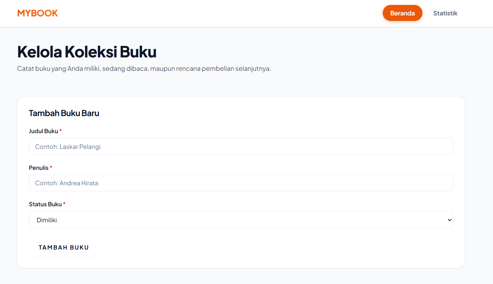
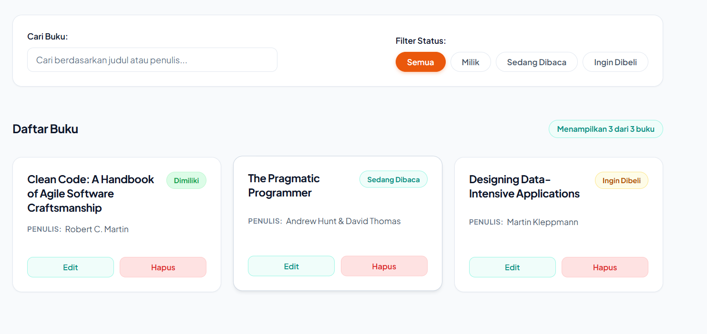
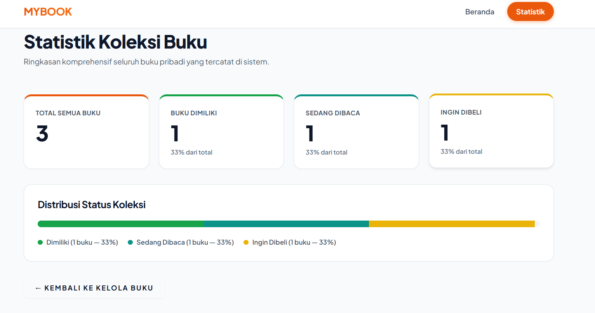
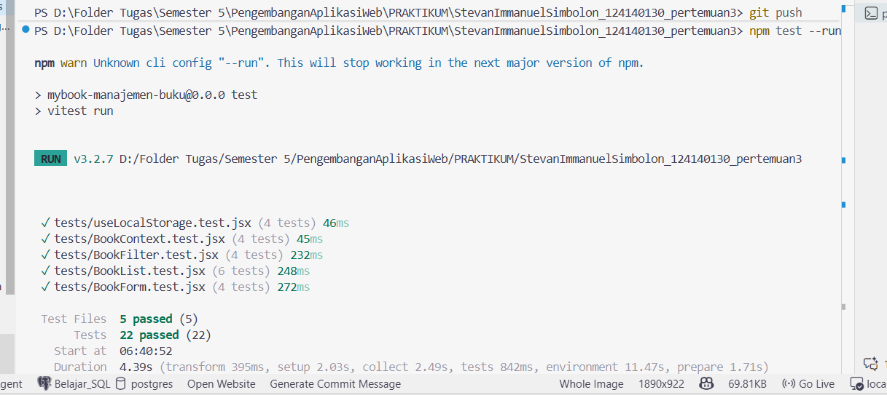

- **Nama**: Stevan Immanuel Simbolon
- **NIM**: 124140130
- **Praktikum**: Pengembangan Aplikasi Web (Pertemuan 3)

---

## 1. Deskripsi Aplikasi

**MyBook** adalah aplikasi Single Page Application (SPA) yang memungkinkan pengguna mengelola inventaris buku pribadi secara efisien. Data tersimpan secara persisten di penyimpanan peramban (_browser LocalStorage_).

### Fitur Utama:

1. **CRUD Buku Lengkap**: Menambah buku baru, membaca daftar koleksi, memperbarui/mengedit data buku, serta menghapus buku dengan konfirmasi dialog browser.
2. **Pencarian Real-Time**: Pencarian cepat multi-kriteria berdasarkan judul buku dan nama penulis buku secara bersamaan.
3. **Filter Kategori Cepat (Filter Chips)**: Filter interaktif per kategori status buku (`Semua`, `Dimiliki`, `Sedang Dibaca`, `Ingin Dibeli`).
4. **Dasbor Statistik Koleksi**: Halaman analitik khusus yang menampilkan total buku, kuantitas per status, rasio persentase, serta bilah distribusi kemajuan visual.
5. **Validasi Formulir Komprehensif**: Validasi field judul dan penulis wajib diisi (tidak boleh kosong atau hanya spasi), pemilihan status wajib valid, dilengkapi feedback pesan kesalahan dan banner sukses otomatis.
6. **Desain Antarmuka LocalGuide**: Antarmuka modern, responsif, dan kontras dengan palet warna Red-Orange (`#EA580C`), Teal (`#0D9488`), Yellow (`#EAB308`), serta tipografi `Plus Jakarta Sans`.

---

## 2. Instruksi Instalasi & Menjalankan Aplikasi

### Prasyarat Sistem

- **Node.js**: Versi 18.0.0 atau lebih baru
- **npm**: Versi 9.0.0 atau lebih baru

### Langkah-Langkah Menjalankan

1. **Clone atau Buka Direktori Proyek**

   ```bash
   cd StevanImmanuelSimbolon_124140130_pertemuan3
   ```

2. **Instalasi Dependensi**

   ```bash
   npm install
   ```

3. **Menjalankan Server Pengembangan (Development Mode)**

   ```bash
   npm run dev
   ```

   Buka peramban di tautan yang ditampilkan di terminal (umumnya `http://localhost:5173`).

4. **Menjalankan Pengujian Otomatis (Unit Testing)**

   ```bash
   npm test
   ```

   Atau untuk eksekusi sekali jalan:

   ```bash
   npm test -- --run
   ```

5. **Membuat Build Produksi & Menjalankan Preview**
   ```bash
   npm run build
   npm run preview
   ```

---

## 3. Screenshot Antarmuka Aplikasi

### A. Halaman Beranda & Form Tambah Buku


_Formulir penambahan buku baru dengan input judul, penulis, pilihan status buku, dan navigasi tab header._

### B. Fitur Pencarian, Filter Status & Daftar Koleksi Buku


_Fitur pencarian real-time judul/penulis, filter chips status (Semua, Milik, Sedang Dibaca, Ingin Dibeli), serta grid kartu buku lengkap dengan badge status dan aksi Edit/Hapus._

### C. Halaman Statistik & Analisis Koleksi


_Dasbor statistik koleksi buku berisi ringkasan kartu metrik total, rincian tiap status buku, persentase rasio, dan bilah progres distribusi koleksi._

---

## 4. Penjelasan Fitur React yang Digunakan

Aplikasi mengimplementasikan standar modern React 19 dengan pola arsitektur modular dan pemisahan tanggung jawab (separation of concerns):

### A. Struktur Tiga Komponen Inti

Struktur komponen modular diletakkan di bawah `src/components/`:

1. **`BookForm` (`src/components/BookForm/`)**:
   - Form input terkontrol (_controlled component_) untuk input judul, penulis, dan status buku.
   - Menangani mode ganda: Tambah Buku Baru dan Edit Buku.
   - Menjalankan validasi input di sisi klien dan menampilkan pesan kesalahan spesifik per field.
2. **`BookFilter` (`src/components/BookFilter/`)**:
   - Komponen pencarian real-time dengan tombol reset cepat (clear search).
   - Filter chips interaktif untuk memilih kategori status buku yang ditampilkan.
3. **`BookList` (`src/components/BookList/`)**:
   - Merender koleksi buku dalam bentuk grid kartu responsif.
   - Menampilkan status badge semantik berdesain pill.
   - Menyediakan tombol pemicu Edit dan Hapus (dilengkapi modal dialog konfirmasi browser).
   - Menyediakan _empty state_ informatif saat daftar buku kosong atau tidak ditemukan.

### B. Global State Management (React Context API)

- **`BookContext` (`src/context/BookContext.jsx`)**:
  - Menyediakan single source of truth untuk seluruh state buku (`books`, `editingBook`).
  - Menyediakan fungsi mutasi CRUD: `addBook`, `updateBook`, `deleteBook`, `setEditingBook`.
  - Diekspos melalui custom hook `useBooks()` untuk konsumsi komponen yang bersih tanpa _prop-drilling_.

### C. React Hooks Bawaan

- **`useState`**:
  - Digunakan pada form untuk mengelola state input (`formData`), error validasi (`errors`), dan notifikasi sukses (`successMessage`).
  - Digunakan di `Home.jsx` untuk menyimpan kata kunci pencarian (`searchTerm`) dan filter status (`statusFilter`).
- **`useEffect`**:
  - Dipakai di `BookForm` untuk mengisi form otomatis saat mode edit aktif atau mengosongkannya kembali saat beralih ke mode tambah.
  - Mengelola _timer_ pembersihan pesan sukses secara otomatis setelah 3 detik.
  - Dipakai di `useLocalStorage` untuk sinkronisasi mutasi data ke `window.localStorage` dan sinkronisasi lintas-tab peramban (`storage` event).
- **`useMemo`**:
  - Diimplementasikan di custom hook `useBookStats` untuk menghitung agregasi total buku, jumlah status milik, baca, dan beli secara efisien hanya saat array `books` berubah referensinya.
- **`useContext`**:
  - Menghubungkan komponen konsumen langsung ke `BookContext`.

### D. Custom Hooks

1. **`useLocalStorage` (`src/hooks/useLocalStorage.js`)**:
   - Mengenkapsulasi logika pembacaan awal, parsing JSON yang aman dengan penanganan exception `try-catch`, dan penulisan otomatis data ke `localStorage`.
2. **`useBookStats` (`src/hooks/useBookStats.js`)**:
   - Menghitung kalkulasi agregasi statistik koleksi buku secara reaktif dan ter-memoisasi.

### E. Client-Side Routing (React Router DOM)

- Menggunakan `BrowserRouter`, `Routes`, `Route`, `NavLink`, dan `Link` dari `react-router-dom`:
  - Rute `/`: Halaman beranda manajemen koleksi buku (`Home`).
  - Rute `/stats`: Halaman statistik dan metrik analitik (`Stats`).
  - Rute `*`: Fallback halaman 404 Not Found yang ramah pengguna.

### F. Validasi Tipe Data (PropTypes)

- Seluruh komponen presentasional (`BookForm`, `BookFilter`, `BookList`) divalidasi menggunakan pustaka `prop-types` untuk memastikan parameter props sesuai kontrak tipe data.

---

## 5. Komentar dalam Kode untuk Bagian-bagian Penting

Setiap berkas kode sumber telah dilengkapi dokumentasi komentar teknis berbahasa Indonesia secara eksplisit:

- **JSDoc Komprehensif**: Mendokumentasikan tujuan komponen, kontrak parameter props, nilai return, serta penanganan tipe data.
- **Komentar Alur Logika State**: Menjelaskan inisialisasi state, logika percabangan kondisi tambah vs edit, dan alur pemanggilan setter.
- **Komentar Validasi Domain**: Menjelaskan sanitasi whitespace (trimming), aturan field wajib, dan pencocokan whitelist opsi status.
- **Komentar Aksesibilitas (a11y)**: Menjelaskan atribut ARIA (`aria-label`, `aria-invalid`, `aria-describedby`, `role="alert"`).

Contoh potongan komentar pada `src/components/BookForm/BookForm.jsx`:

```jsx
/**
 * Handler Perubahan Input (Change Handler)
 * Memperbarui nilai field pada state formData secara dinamis dan membersihkan error validasi field tersebut.
 *
 * @param {React.ChangeEvent<HTMLInputElement|HTMLSelectElement>} e - Event perubahan input dari DOM
 */
const handleChange = (e) => {
  const { name, value } = e.target;
  // Perbarui nilai state form secara imutabel
  setFormData((prev) => ({ ...prev, [name]: value }));
  // Hapus pesan error validasi pada field yang sedang diedit pengguna
  if (errors[name]) {
    setErrors((prev) => ({ ...prev, [name]: "" }));
  }
};
```

---

## 6. Laporan Testing

Pengujian otomatis dibangun menggunakan **Vitest** dan **React Testing Library** dengan konfigurasi DOM simulasi (`jsdom`).

### Ringkasan Hasil Pengujian:

- **Total Test Suites**: 5 berkas pengujian
- **Total Unit Tests**: 22 kasus pengujian
- **Hasil Eksekusi**: **100% Passed (Lulus Semua)**

### Rincian Modul yang Diuji:

1. `tests/useLocalStorage.test.jsx` (4 pengujian):
   - Inisialisasi nilai awal dari default value.
   - Pembacaan data yang telah tersimpan di `localStorage`.
   - Pembaruan nilai state dan sinkronisasi ke `localStorage`.
   - Penanganan fallback graceful saat data di `localStorage` rusak/invalid JSON.
2. `tests/BookContext.test.jsx` (4 pengujian):
   - Menambah buku baru ke dalam state koleksi.
   - Mengedit data buku yang telah ada berdasarkan ID.
   - Menghapus buku dari koleksi berdasarkan ID.
   - Mengatur dan mereset status buku yang sedang diedit (`editingBook`).
3. `tests/BookForm.test.jsx` (4 pengujian):
   - Menolak submit dan menampilkan pesan error saat judul buku kosong.
   - Menolak submit dan menampilkan pesan error saat nama penulis kosong.
   - Memanggil callback `onSubmit` dengan payload data benar saat form valid.
   - Mengisi otomatis seluruh field form saat mode edit aktif.
4. `tests/BookList.test.jsx` (6 pengujian):
   - Merender seluruh kartu buku sesuai daftar data yang diberikan.
   - Menampilkan status badge yang sesuai (`milik`, `baca`, `beli`).
   - Memanggil fungsi callback `onEdit` saat tombol Edit diklik.
   - Menampilkan dialog konfirmasi dan memanggil `onDelete` saat tombol Hapus dikonfirmasi.
   - Membatalkan penghapusan saat dialog konfirmasi ditolak pengguna.
   - Menampilkan tampilan kosong (_empty state_) informatif saat tidak ada buku.
5. `tests/BookFilter.test.jsx` (4 pengujian):
   - Merender seluruh tombol filter kategori status.
   - Memanggil callback `onStatusChange` saat filter kategori diklik.
   - Memanggil callback `onSearchChange` saat pengguna mengetik kata kunci.
   - Membersihkan kolom pencarian saat tombol reset (✕) diklik.

### Screenshot Hasil Eksekusi Unit Test di Terminal


