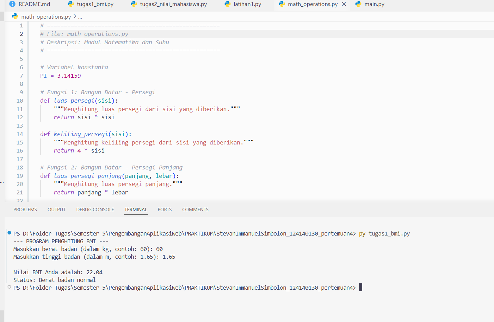
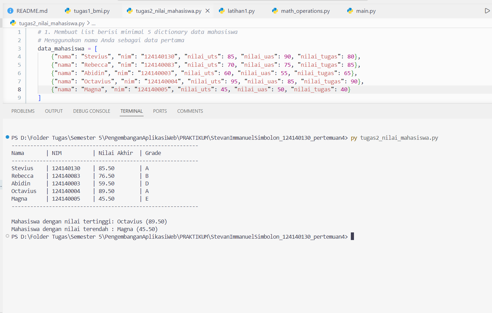
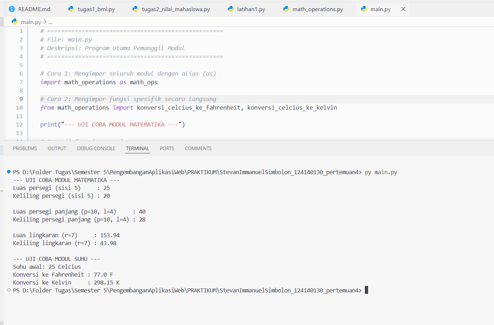

# Praktikum Pertemuan 4: Dasar Pemrograman Python

**Nama**: Stevan Immanuel Simbolon  
**NIM**: 124140130

## Deskripsi Singkat

Repositori ini berisi solusi praktikum pemrograman dasar Python.

1. **`tugas1_bmi.py`**: Program yang meminta input berat badan (kg) dan tinggi badan (m, contoh: `1.65`). Program dilengkapi deteksi otomatis konversi cm ke m bila nilai di atas 3, lalu menghitung skor BMI dan menampilkan kategorinya menggunakan percabangan `if-elif-else`.
2. **`tugas2_nilai_mahasiswa.py`**: Program pengelolaan data menggunakan List dan Dictionary. Program akan menghitung nilai akhir dengan bobot, grade huruf, dan melacak peraih nilai tertinggi serta terendah melalui proses iterasi (`for loop`).
3. **`math_operations.py`** dan **`main.py`**: Pembuatan modul kustom. Berkas `math_operations.py` memuat kumpulan fungsi hitung geometri dan suhu beserta dokumentasinya. Berkas `main.py` menjadi program pemanggil menggunakan dua cara impor berbeda.

## Instruksi Cara Menjalankan Skrip

Install Python di komputer. Buka terminal (atau terminal bawaan VS Code), pastikan direktori aktif berada di folder ini, lalu jalankan masing-masing perintah berikut:

Untuk menjalankan Program Penghitung BMI:

```bash
python tugas1_bmi.py
```

Untuk menjalankan Program Pengelolaan Nilai Mahasiswa:

```bash
python tugas2_nilai_mahasiswa.py
```

Untuk menjalankan Program Pemanggil Modul Matematika & Suhu:

```bash
python main.py
```

## Dokumentasi Hasil Eksekusi

### 1. Tugas 1: Penghitung BMI (`tugas1_bmi.py`)



---

### 2. Tugas 2: Pengelolaan Nilai Mahasiswa (`tugas2_nilai_mahasiswa.py`)



---

### 3. Tugas 3: Modul Matematika & Suhu (`math_operations.py` & `main.py`)


