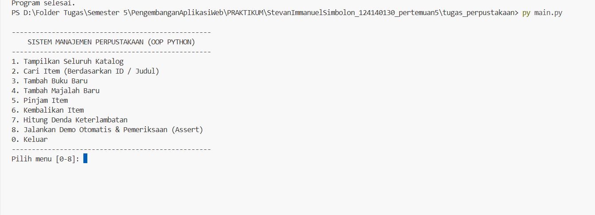
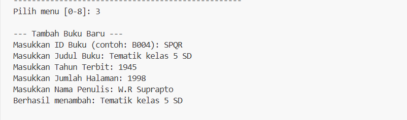
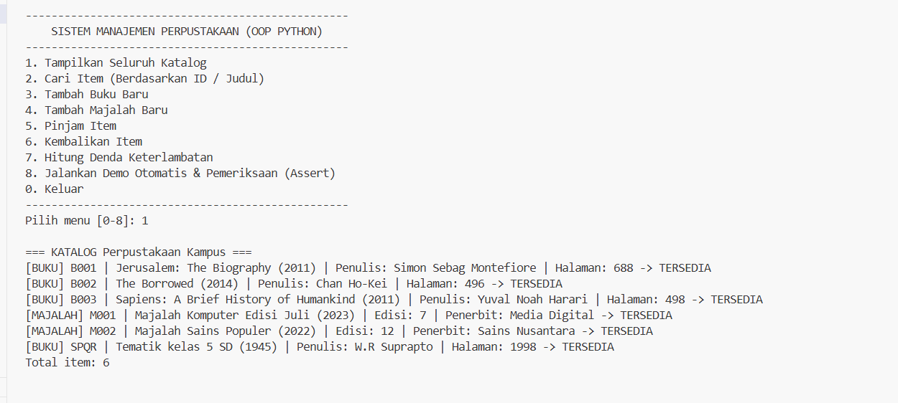
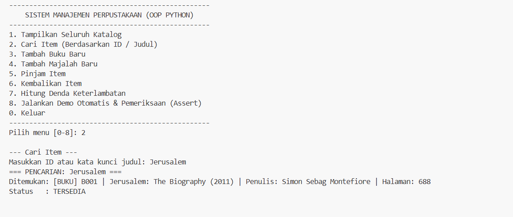

# Pertemuan 5 — Object-Oriented Programming (OOP) di Python

## Identitas Mahasiswa

| Keterangan      | Isi                       |
| --------------- | ------------------------- |
| Nama Lengkap    | Stevan Immanuel Simbolon  |
| NIM             | 124140130                 |
| Kelas Praktikum | RB                        |
| Mata Kuliah     | Pengembangan Aplikasi Web |

## Deskripsi Program

Program ini adalah simulasi sistem perpustakaan sederhana yang dibuat dengan
Python dan menerapkan empat pilar OOP.

## Panduan Menjalankan Program

Latihan:

```bash
cd latihan
python 01_class_object.py
```

Tugas Perpustakaan:

Masuk ke folder tugas:
```bash
cd tugas_perpustakaan
```

1. **Mode Interaktif (Menu CLI)**:
   ```bash
   python main.py
   ```
   Pengguna dapat memilih menu angka untuk menambah buku/majalah, menampilkan katalog, mencari item, meminjam, mengembalikan, menghitung denda, atau menjalankan demonstrasi langsung.

2. **Mode Demonstrasi Otomatis Langsung**:
   ```bash
   python main.py --demo
   ```
   Menjalankan seluruh alur simulasi secara otomatis beserta pemeriksaan `assert`.

## Screenshot Output

Bukti tangkapan layar terminal saat program dijalankan dan mendemonstrasikan fitur-fitur yang diminta:

### 1. Tampilan Saat Program Dijalankan (Running Program / Menu Interaktif)



### 2. Fitur Penambahan Item & Penolakan ID Ganda



### 3. Fitur Penampilan Katalog Perpustakaan



### 4. Fitur Pencarian Item (ID & Judul)


